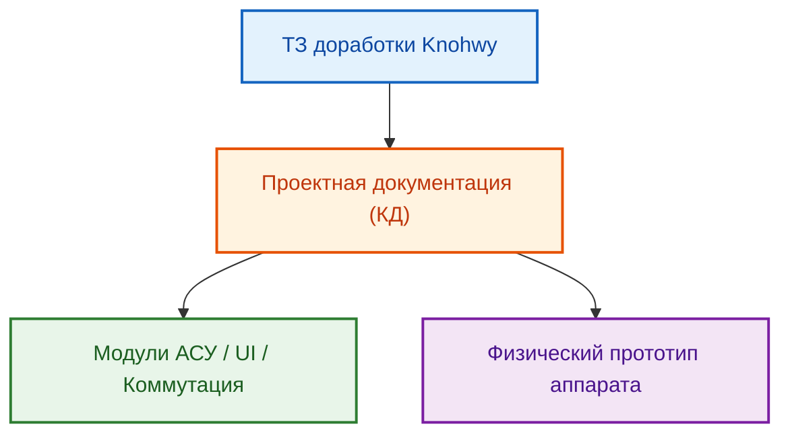

# README: Доработка металлоконструкции вендингового аппарата «Horizon VM» (8/2026-n1-горизонт)

## 1. ВВЕДЕНИЕ И ПАСПОРТ КОМПОНЕНТА / СПЕЦИФИКАЦИИ

### 1.1. Назначение и бизнес-роль в холдинге
Данный проект направлен на конструкционную доработку базовой металлической конструкции промышленного вендингового аппарата, закупаемого в Китае, для интеграции собственной вендинговой системы бренда «Horizon VM». Проект обеспечивает выполнение требований по эргономике, интеграции АСУ, безопасности и транспортировке.

### 1.2. Паспортная таблица метаданных
| Атрибут | Значение |
| :--- | :--- |
| **Код проекта** | 8/2026-n1-горизонт |
| **Тип работ** | Конструкторская доработка, интеграция АСУ |
| **Бренд** | Horizon VM |
| **Статус** | Активная фаза доработки |
| **Ведущий архитектор** | Кукушкин И.Н. |

### 1.3. Архитектурная схема взаимодействия (Mermaid)

## 2. ИНСТРУКЦИЯ ПО ЭКСПЛУАТАЦИИ / РАБОЧИЙ ПРОЦЕСС
Процесс доработки состоит из поэтапной реализации конструкторских задач согласно приоритетам:
1.  **Этап 1 (Приоритет 1):** Разработка модуля электроники, коммутации сети ~230В, установки моноблока в Дверь №2, разработка транспортной тары.
2.  **Этап 2 (Приоритет 2):** Переработка точек крепления колес, разработка кронштейнов камер видеонаблюдения.
3.  **Этап 3 (Приоритет 3):** Переработка Двери №1, установка блокирующих элементов двери.

## 3. ПОЛНЫЙ РЕЕСТР И СТРУКТУРА ДАННЫХ
*(Реестр будет наполняться по мере разработки КД и спецификаций в папке `02__Спецификации`)*

## 4. СПЕЦИФИКАЦИЯ ФУНКЦИЙ / КОМАНД DSL
*(В данном проекте функционал определяется через КД. Будет добавлено описание API управления АСУ при необходимости.)*

## 5. МАТРИЦА ОГРАНИЧЕНИЙ И БЕЗОПАСНОСТИ
- Использование только утвержденных компонентов для `production`.
- Соблюдение требований электробезопасности при коммутации сети ~230В.
- Защита интеллектуальной собственности (КД) в соответствии с соглашением о конфиденциальности.

## 6. ПРАКТИЧЕСКИЙ РАЗДЕЛ (РЕАЛЬНЫЕ БИЗНЕС-СЦЕНАРИИ)
**Сценарий «Производственная адаптация»:**
1. Вход: Базовый аппарат (Китай) + ТЗ Knohwy.
2. Обработка: Разработка КД модуля электроники -> Изготовление -> Монтаж.
3. Результат: Аппарат Horizon VM, готовый к эксплуатации.

## 7. ДИАГНОСТИКА И ТИПОВЫЕ ОШИБКИ (TROUBLESHOOTING)
| Текст ошибки | Причина | Способ устранения |
| :--- | :--- | :--- |
| Некорректная установка модуля | Ошибка топологии | Проверка чертежей КД |
| Повреждения при транспортировке | Отсутствие тары | Использование специализированной тары |

## 8. КАТАЛОГ СВЯЗЕЙ И ПЕРЕКРЁСТНЫЕ ССЫЛКИ
- [ТЗ проекта](./03__Проект/02__ТЗ/ТЗ-доработка%20металлоконструкции%20Knohwy%20rev.01%20v01.md)
- [Спецификации](./02__Спецификации/)
- [Контрагенты](./03__Проект/77__Контрагенты/)
- [Манифест (AGENTS)](./AGENTS.md)
- [Системный контекст (GEMINI)](./GEMINI.md)
